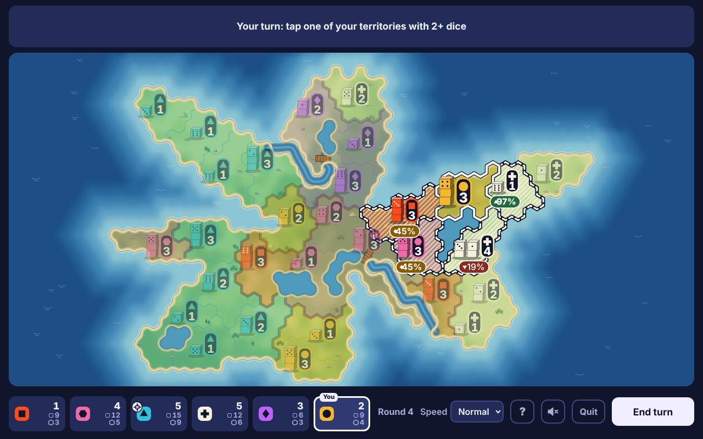
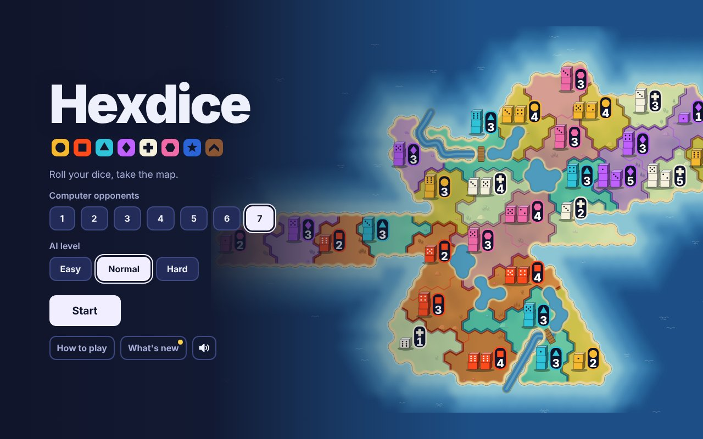

<p align="center">
  
</p>

<h1 align="center">Hexdice</h1>

<p align="center">
  <strong>Roll your dice, take the map.</strong><br>
  A dice-conquest strategy game for the browser: 2 to 8 players on a painted hex continent, you against the computer, on a laptop or a phone.
</p>

<p align="center">
  <a href="https://hexdice.snebold.dk"><strong>Play it at hexdice.snebold.dk</strong></a><br>
  Free, no sign-up, and it works offline after your first visit.
</p>

<p align="center">
  <a href="https://github.com/iOvergaard/hexdice/actions/workflows/deploy.yml"></a>
  <a href="LICENSE"></a>
</p>

<p align="center">
  
</p>

## How to play

### Goal

Take every territory on the map. A player left with none is out.

### The map

- The continent is split into 30 territories. You can attack an enemy territory that touches one of yours.
- The sea and lakes block the way, and a river can only be crossed at its ford, drawn as a bridge.
- The number on a stack is how many dice it holds, up to 8.
- Everyone starts with the same number of dice, nudged a little by turn order so that going first is no advantage.

### Attacking

- On your turn, tap one of your territories with 2 or more dice, then an enemy territory next to it.
- Both sides roll all their dice and the higher total wins. **A tie goes to the defender.** The badge on the target shows your chance of winning.
- **Win:** you take the territory and move in all your dice but one.
- The territory you took stays selected while it can attack again: tap the next target to carry on, or tap it again to let go.
- **Lose:** your territory drops to 1 die.
- **Draw:** it drops to as many dice as the defender had, losing at least 1.
- Attack as often as you like, then end your turn.

<details>
<summary>Your chance of winning an attack</summary>

| Attacker \ Defender | 1 | 2 | 3 | 4 | 5 | 6 | 7 | 8 |
|---|---|---|---|---|---|---|---|---|
| **2** | 84% | 44% | 15% | 4% | 1% | 0% | 0% | 0% |
| **3** | 97% | 78% | 45% | 19% | 6% | 1% | 0% | 0% |
| **4** | 100% | 94% | 74% | 46% | 22% | 8% | 3% | 1% |
| **5** | 100% | 99% | 91% | 72% | 46% | 24% | 10% | 4% |
| **6** | 100% | 100% | 98% | 88% | 70% | 47% | 26% | 12% |
| **7** | 100% | 100% | 99% | 96% | 86% | 69% | 47% | 27% |
| **8** | 100% | 100% | 100% | 99% | 95% | 84% | 67% | 47% |

Rounded to whole percent. Equal stacks win less than half the time, because ties go to the defender.

</details>

### Reinforcements

- When you end your turn you get 1 die for each territory in your **largest connected group**: the number by your name. The small number under it, by the little die, is how many dice you have on the map.
- You also get +1 die per turn for every player you knock out, for the rest of the game.
- New dice land at random on your territories that border an enemy, up to 8 per territory.
- Dice that don't fit on your front line go to the territories just behind it, nearest the front first. They wait in your reserve (up to 64, shown as +N by your name) only once every territory you hold is full, and come with your next reinforcements.

### Linking up

- While you hold fewer territories than the average of the players still in, a capture that joins two or more of your separate groups earns **+2 dice for each extra group joined**.
- They land on the territory you just took, and any that don't fit go to your reserve. Look for the gold "linked!".

### The final

- In a game of three or more players, the first time a turn ends with only two left, the one with fewer territories makes a **last stand**: +1 die on each of their territories.
- With three of you left, knocking out one rival hands the smaller of the last two a last stand. Knock out both in one turn and nobody gets one.

### The computer players

- **Easy** attacks at random, even against long odds, and sometimes ends its turn early.
- **Normal** attacks when the odds are at least even, or from a full stack of 8 when they are 30% or better. It prefers captures that grow its largest group, break up the leader's or knock a player out, and the whole table gangs up on anyone who runs away with the map. That includes you.

### Tips

- Attack with more dice than the defender.
- Keep your territories joined up: your largest group is your income.
- A short front line gets your new dice where the fighting is, and water makes a cheap wall.
- Knocking out a weak player pays every turn after.

<p align="center">
  
  &nbsp;
  
</p>

## What else is in it

- **Phone and desktop.** Tap a territory, tap a target. On a portrait screen the map turns upright to fill it.
- **Offline.** After one visit the game loads without a connection. A new version arrives the next time you open it online.
- **Continue.** Close the tab mid-game and pick up exactly where you left off.
- **How to play and What's new** are one tap away on the title screen. What's new lists every change by its commit and tells you which version you're on.
- **Game over** opens with the winner's colours, shows how the map changed hands, and ends with a scoreboard: who went out when, and everyone's attacks won and defences held. Then replay the whole game, or watch the rest if you're knocked out early. Copy game puts the seed, the rules and every move on your clipboard, so the game can be replayed and looked at move by move elsewhere.
- **Speed and sound.** Four speeds from Slow to Instant, a skip-to-my-turn button, and synthesised sound with a speaker toggle.
- **Keyboard.** Space ends your turn, or skips ahead while the computer plays; Escape cancels a selection.

## Run it yourself

You need Node 24.

```bash
npm install
npm run dev     # http://localhost:5180
```

## Development

Vite and TypeScript, an SVG board and a plain DOM interface, with no runtime dependencies. The rules engine is pure and deterministic: the same seed and the same moves always give the same game, which makes saving, replays and bug reports cheap.

```bash
npm run check                # types and unit tests
npm run sim -- --games 500   # computer-vs-computer games: crashes, skill gap and game length
npm run e2e                  # browser tests on a desktop and a phone screen
npm run build                # production build in dist/
npm run screenshots          # retake these screenshots from a seeded game (needs npm run dev)
```

Every push to `main` that touches the game runs the tests, plays 2,000 simulated games and deploys to GitHub Pages.

- **Rules and design:** [docs/plan.md](docs/plan.md). Section 3 is the rule set, with the reasons and simulator numbers behind each rule.
- **Changes:** [CHANGELOG.md](CHANGELOG.md), built from [Conventional Commits](https://www.conventionalcommits.org/) and shown in the game under What's new.
- **Playtest reports:** [playtest/](playtest/), one per change, with what was verified by hand.
- **Working on the code:** [CLAUDE.md](CLAUDE.md) has the architecture, conventions and checks.

## Licence

[Mozilla Public License 2.0](LICENSE).
