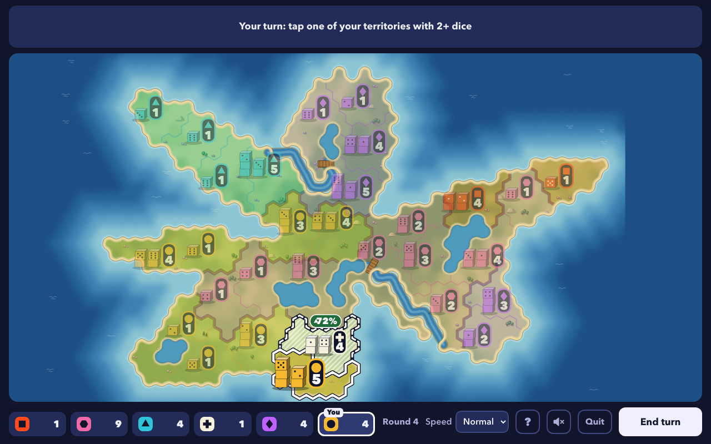
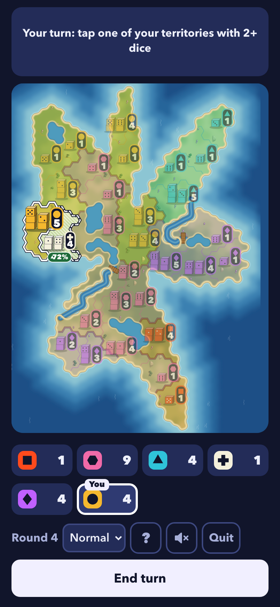
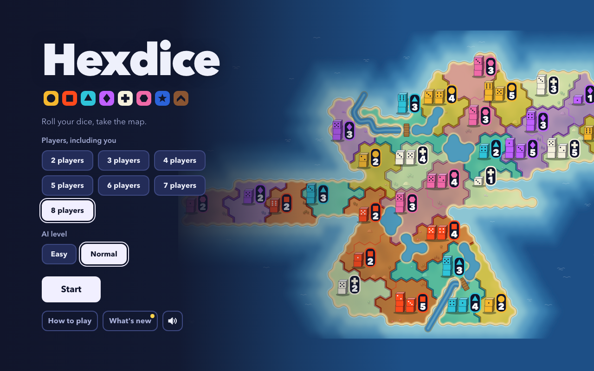

# Hexdice

A dice-conquest strategy game for the browser. Conquer a hex map by rolling against your neighbours, and grow your largest connected region to earn reinforcements.

**Play:** https://hexdice.snebold.dk (deployed from `main` after the tests pass).

<p align="center">
  
</p>

<p align="center">
  
  &nbsp;
  
</p>

```bash
npm install
npm run dev     # http://localhost:5180
```

Rules and design: [docs/plan.md](docs/plan.md). Developer notes: [CLAUDE.md](CLAUDE.md).

The screenshots come from a seeded game: with `npm run dev` running, `npm run screenshots` takes them again.
